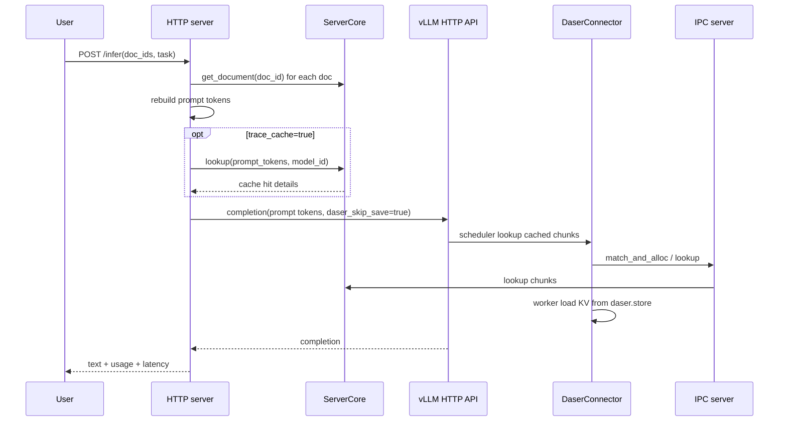
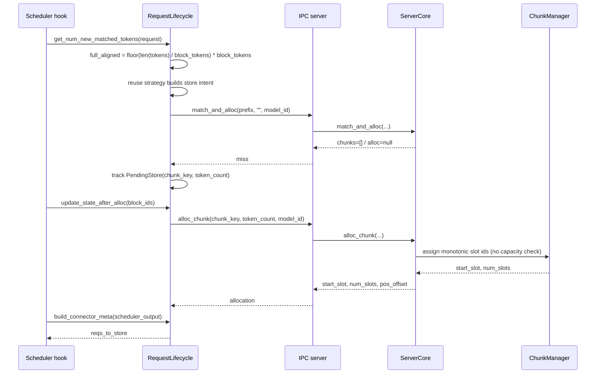
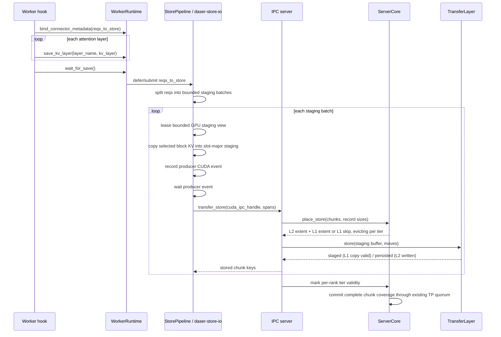
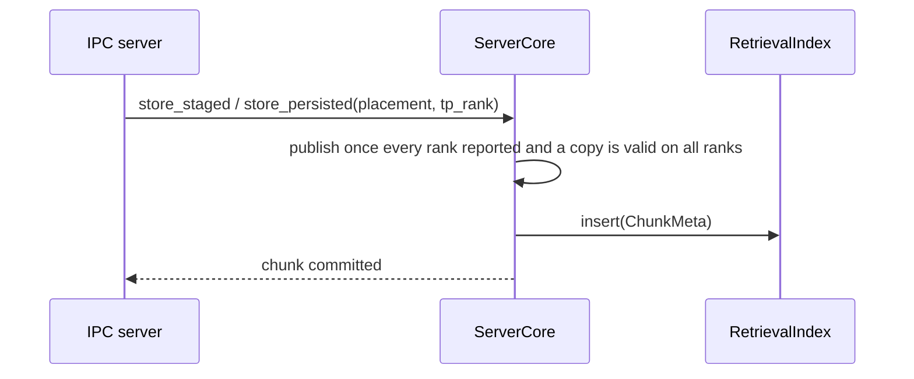
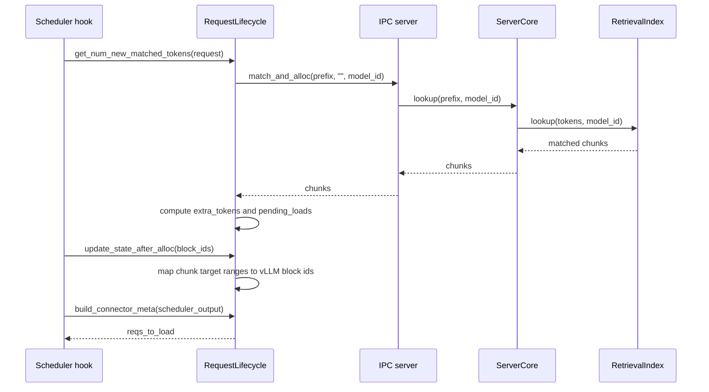
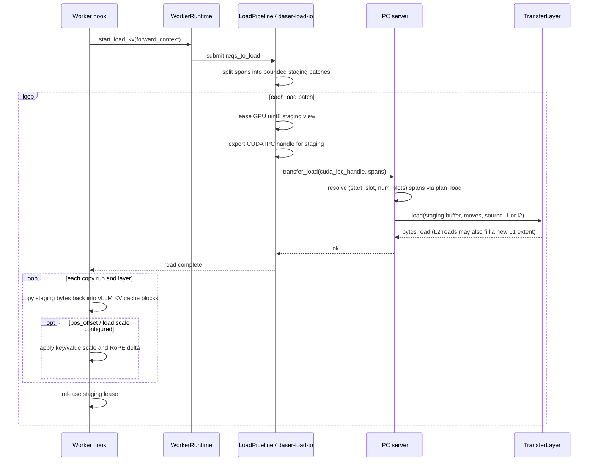
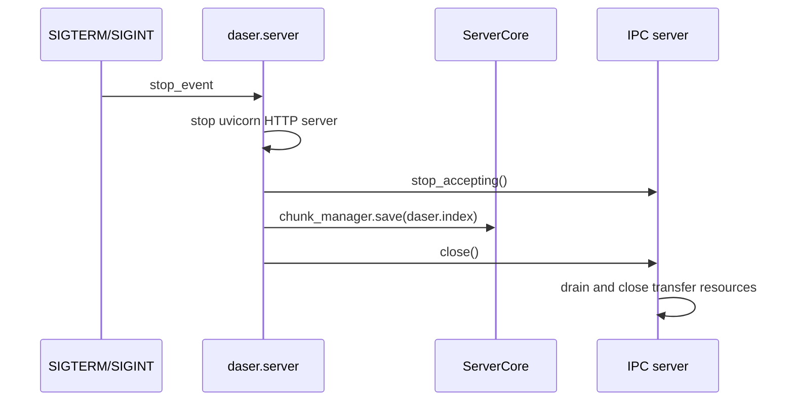

# 数据流程

本文档描述当前 io_uring/L1/L2 主路径。vLLM worker 持有 CUDA context、KV cache
和 staging buffer；DaseR server 通过 IPC 打开 staging mapping，并由
`TransferLayer` 执行 transfer orchestration。GDS 仅是可选兼容 backend，不改变
下面的 connector-to-server IPC 边界。

## 文档上传流程

```mermaid
sequenceDiagram
    participant U as User
    participant HTTP as HTTP server
    participant V as vLLM HTTP API
    participant DC as DaserConnector
    participant IPC as IPC server
    participant C as ServerCore

    U->>HTTP: POST /documents(title, text)
    HTTP->>HTTP: tokenize + chunk + hash chunk keys
    loop each cacheable chunk
        HTTP->>V: prefill(chunk tokens)
        V->>DC: scheduler lookup / alloc
        DC->>IPC: match_and_alloc / alloc_chunk
        IPC->>C: allocate slots (evict cold leaves if full)
        V->>DC: worker save KV
        DC->>IPC: transfer_store(spans, tp_rank)
        IPC->>C: place + store; publish once every rank reported
    end
    HTTP->>C: register_document(doc_id, chunk_keys, tokens)
    C-->>HTTP: cached count
    HTTP-->>U: 201 doc_id
```

上传失败时 HTTP server 返回 `502`，不会注册文档。已经成功 commit 的 KV
chunk 可以保留在 store 中，后续相同内容仍可复用。

---

## 推理流程



`/infer` 会向 vLLM 传 `kv_transfer_params={"daser_skip_save": true}`。文档
chunk 已在上传时缓存，task suffix 通常是一次性的，因此推理请求不再把整个
拼接 prompt 重新写入 DaseR。

---

## KV Store 流程

### 阶段一：Scheduler 查找 miss 并分配 slot



`alloc_chunk` 只预留 metadata，chunk 还不会进入 `RetrievalIndex`。

### 阶段二：Worker staging 和批量写入



`wait_for_save` 只把当前 worker step 的 KV store 意图加入待完成 FIFO，不会
立即读取 live KV cache。`get_finished` 收到 vLLM 的 `finished_req_ids` 后，
按请求进入 FIFO 的顺序提交全部已完成请求。后台 `daser-store-io` loop 使用
staging pool depth 的异步信号量限制实际 snapshot/transfer 并发；前一个 store
释放 staging lease 后，队列中的下一个 store 自动进入，不依赖后续 vLLM
connector step 或 benchmark dummy poll。`shutdown` 会阻塞等待所有 pending
store future 完成。

### 阶段三：Commit 发布



commit 完成后 chunk 才能被 lookup 命中。`transfer_store` 在本请求的 chunk 都有
L1 extent 时于 staging 完成后回复，否则等 L2 写完；L2 写失败时 `store_failed`
丢弃不完整副本，没有副本的未 commit chunk 被移除，L2-only 请求回复错误。

---

## KV Load 流程

### 阶段一：Scheduler 查找 hit



`PrefixHashIndex` 返回 rolling-prefix 的连续 slot 命中；
`ChunkReuseIndex` 可以返回多个 block-aligned chunks。Scheduler 会确保返回给
vLLM 的 external tokens 是连续可用的前缀范围。

vLLM 分配 block 失败时，下一个 step 会对同一个等待请求再调一次
`get_num_new_matched_tokens`。lookup 回复带有 server 的 index epoch，这个计数
在每次 chunk 被移出索引时递增。如果重试的窗口（`num_computed_tokens` 和前缀
长度）没变，且 epoch 没变，`RequestLifecycle` 就直接复用上一次的结果，不再
发完整的 token lookup。epoch 每个 scheduler step 至多读一次：优先取本 step
lookup 回复里的值，没有才发一次 `index_epoch` RPC。同一 step 内稍后发生的
删除要到下一个 step 才能看到，这和 lookup 与 load 之间本来就有的时间窗是同
一类。

### 阶段二：Worker 一次性加载



异步 load 在 `WAITING_FOR_REMOTE_KVS` 期间完成，不在 forward 关键路径上。
load span 只带 `(start_slot, num_slots)` 和 `tp_rank`，server 用 `plan_load` 按
chunk 选层；整 chunk 的 L2 读在 L1 可接纳时同一次读 promote 进 L1。回复中的
`l1_segments` / `l2_segments` 是本次读各层的 chunk 段数。

开启 prefetch（`prefetch_max_requests > 0`）时，scheduler 先 `lookup_prefetch`
固定外部窗口的 chunk，再 `transfer_prefetch` 把只有 L2 的 chunk promote 进 L1；
错误回复表示 lease 不可用，scheduler 释放 lease 后按普通 load 继续。lease 在请求
load 结束后由 `release_transfer_lease` 释放。prefix lookup 返回的 run 可能合并
多个相邻 chunk，server 按 chunk（`resolve_slots`）取 lease 和 promote。
`layerwise_load`（默认关）只作用于 L1 副本已被 prefetch lease 固定的命中：`start_load_kv` 启动按层
恢复，`wait_for_layer_load(layer_name)` 让该层 attention 只等自己那一层。一个 step
里可能有多个 layerwise 请求，每个请求各带自己的 lease。每层只发一次
`transfer_load_runs`，带上这些请求的全部 `lease_ids`。vLLM 只在
uniform decode batch 上 replay FULL CUDA graph（会跳过逐层 hook），所以 forward
context 为 FULL 或没有 attention metadata 时，`start_load_kv` 在返回前等完全部层。

---

## 关机持久化流程



`daser.index` 保存 `MetadataStore`、`DocRegistry`、`next_slot`、每个 chunk 的
L2 偏移和 record 长度，以及粒度和 lane 大小；L2 分配器和淘汰树在加载时由索引
重建，L1 为空。
启动时恢复 metadata 后，`ServerCore.rebuild_retrieval_index()` 会从 committed
chunk metadata 重建检索索引。

关机采用 fast consistent stop。收到 SIGTERM/SIGINT 后，server 先停止 HTTP
和 IPC 新请求入口，再保存当时已经 commit 的 chunk metadata 和已经完成注册的
文档。connector 侧尚未完成的后台写入或尚未发布的 chunk 不会进入
`daser.index`；即使底层 `daser.store` 已有部分字节，重启后也不会被检索索引命中。
已经 commit 但还没有绑定到文档的 orphan chunk 会作为普通 cache chunk 保留，
后续再次上传相同内容时可以通过相同 chunk key 复用。
